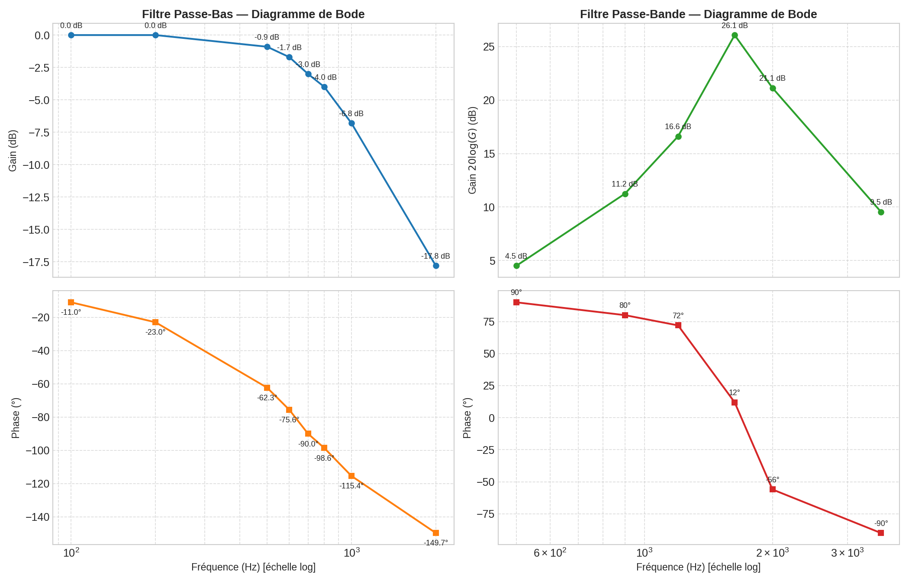
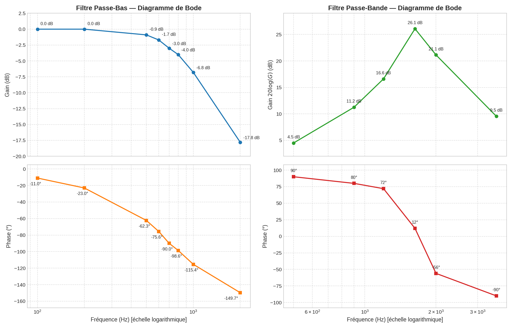
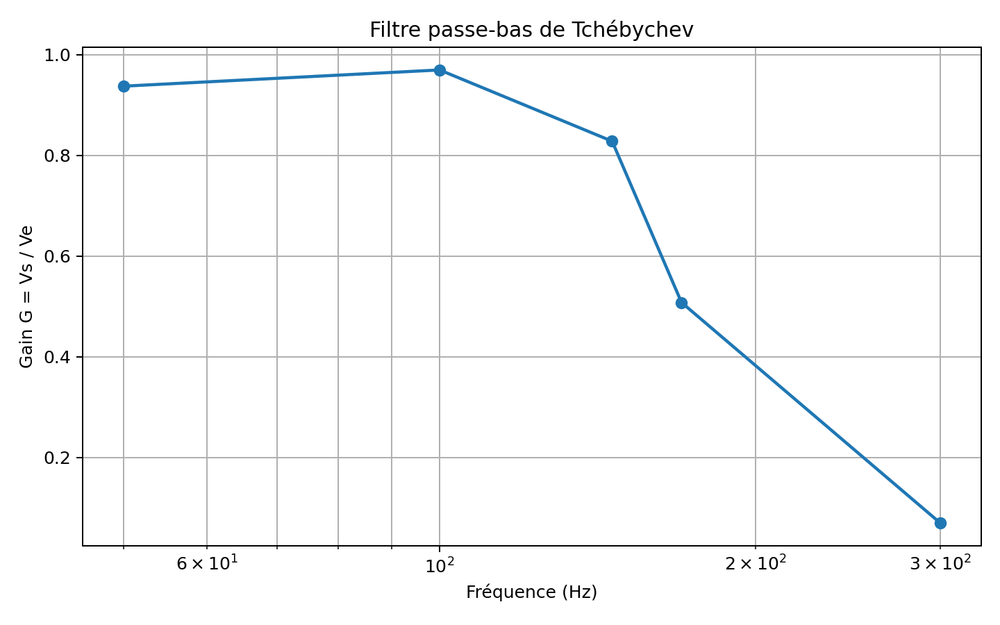
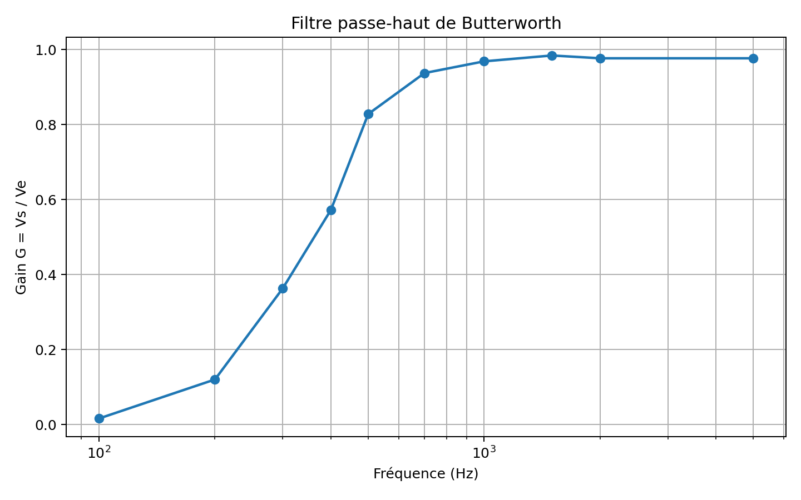
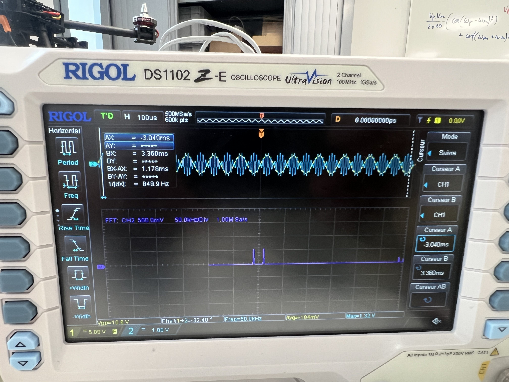
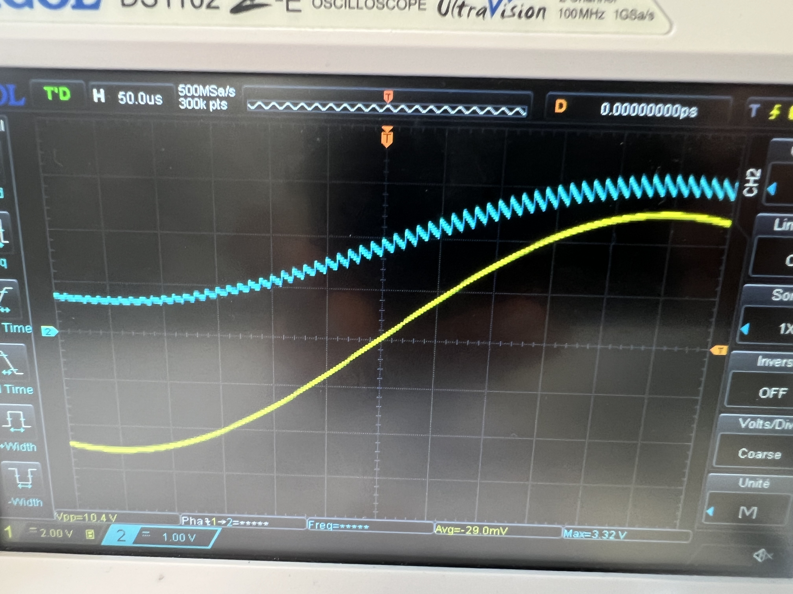
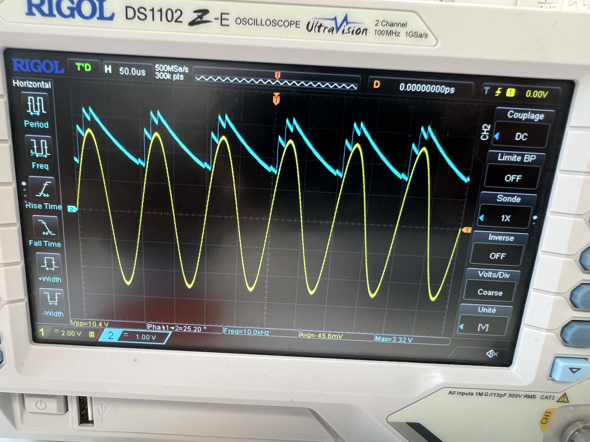
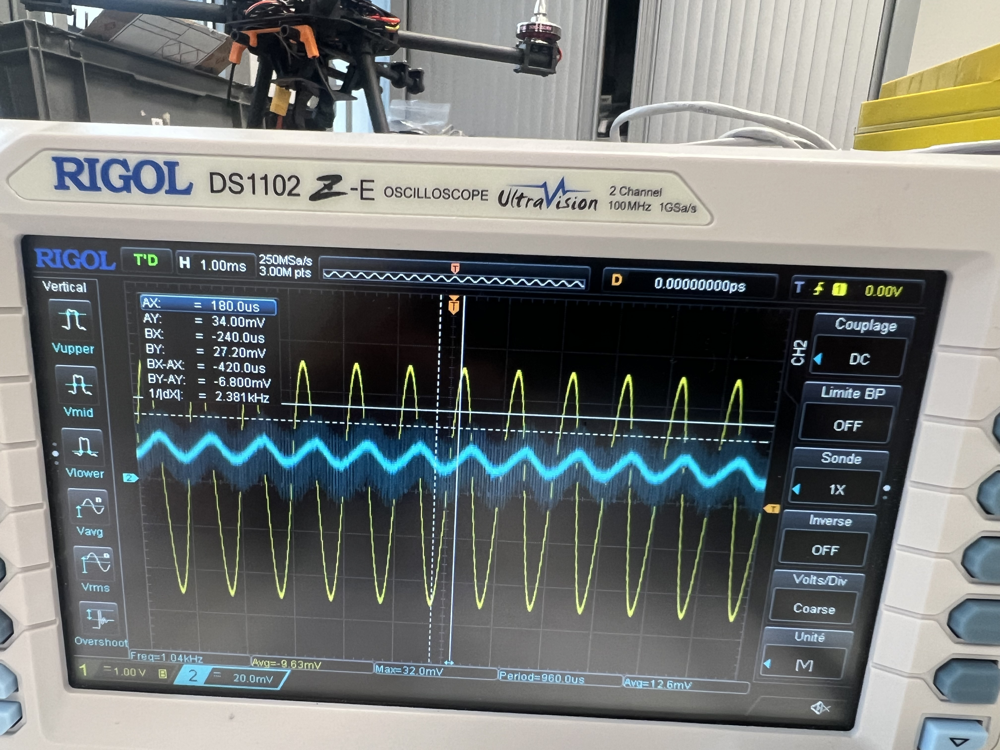
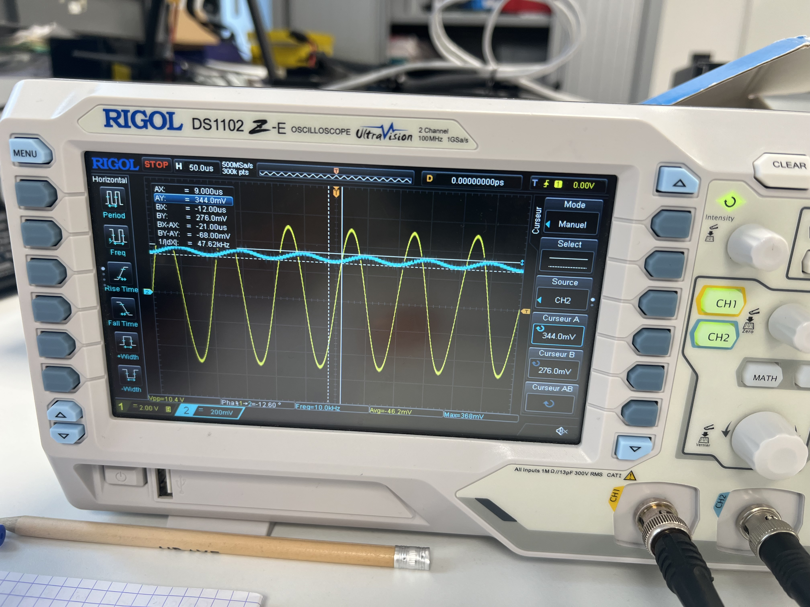

# Comptes rendus TP 1 à 6

Diallo Ibrahima et Nans

Comptes rendus des travaux pratiques de Systèmes Électroniques.

# TP n°1 : Filtres actifs du second ordre 
## Préparation 

Structure de Rauch permet de réaliser des filtres actifs du second ordre de type passe bas, passe haut et passe bande. 

**1)** Expression de la fonction de transfert $H(p) = \frac{V_s}{V_e}$ en fonction des admitances : $Y_1, Y_2, Y_3, Y_4 \ et \ Y_5$

Sur la structure de Rauch, nous pouvons établir deux tensions :
* $V_A$ : la tension du nœud $A$ entre $Y_1$, $Y_2$, $Y_3$ et $Y_4$.
* $V_B$ : la tension du nœud $B$ entre $Y_3$ et $Y_5$ (entrée inverseuse de l'AOP, avec $V_B = 0$).

### 1) Fonction de transfert

**Appliquons la loi des nœuds au point $B$ :**
$$Y_3(V_A - 0) + Y_5(V_s - 0) = 0 \Rightarrow V_A = -\frac{Y_5}{Y_3} V_s$$

**Appliquons la loi des nœuds au point $A$ :**
$$Y_1(V_A - V_e) + Y_2 V_A + Y_3 V_A + Y_4(V_A - V_s) = 0$$
$$V_A (Y_1 + Y_2 + Y_3 + Y_4) - Y_1 V_e - Y_4 V_s = 0$$

On remplace $V_A$ par son expression, ce qui nous donne :
$$H(p) = \frac{V_s}{V_e} = -\frac{Y_1 Y_3}{Y_3 Y_4 + Y_5(Y_1 + Y_2 + Y_3 + Y_4)}$$

---

### 2) Déterminons le type des admittances $Y_i$ (Résistance ou condensateur) pour réaliser des filtres du second ordre

* **Passe-bas :**
  Forme canonique :
  $$H(p) = \frac{A}{\frac{p^2}{\omega_0^2} + \frac{2m}{\omega_0}p + 1}$$
  Il faut une constante au numérateur, soit $Y_1$ et $Y_3$ des résistances, et aussi $Y_4$ pour la constante du dénominateur. Donc :
  * $Y_1, Y_3, Y_4$ = résistances
  * $Y_2, Y_5$ = condensateurs

* **Passe-haut :**
  Forme canonique :
  $$H(p) = \frac{A \frac{p^2}{\omega_0^2}}{\frac{p^2}{\omega_0^2} + \frac{2m}{\omega_0}p + 1}$$
  Il faut $p^2$ au numérateur, donc :
  * $Y_1, Y_3, Y_4$ = condensateurs
  * $Y_2, Y_5$ = résistances

* **Passe-bande :**
  Forme canonique :
  $$H(p) = \frac{A \frac{2m}{\omega_0}p}{\frac{p^2}{\omega_0^2} + \frac{2m}{\omega_0}p + 1}$$
  Il faut $p$ au numérateur, donc :
  * $Y_1, Y_2$ = condensateurs *(ou $Y_2, Y_3$ selon le montage)*
  * $Y_3, Y_5, Y_4$ = résistances *(ou $Y_1, Y_4, Y_5$)*

---

### 3) Calcul des composants pour les 3 filtres

* **$C_5$ pour le filtre passe-bas :**
  Après identification avec la forme canonique, on trouve :
  $$\frac{1}{\omega_0^2} = R^2 C_2 C_5 \quad \text{et} \quad \frac{2m}{\omega_0} = 3 R C_5$$
  On en déduit :
  $$\omega_0 = \frac{1}{R\sqrt{C_2 C_5}} \quad \text{et} \quad m = \frac{3}{2}\sqrt{\frac{C_5}{C_2}}$$
  Donc :
  $$C_5 = C_2 \left(\frac{2m}{3}\right)^2$$

* **Fréquence de coupure :**
  $$f_0 = \frac{\omega_0}{2\pi}$$

* **Gain et fréquence de résonance $f_r$ :**
  $$f_r = f_0\sqrt{1 - 2m^2} \quad \text{(passe-bas) ou } f_r = \frac{f_0}{\sqrt{1 - 2m^2}} \quad \text{(passe-haut)}$$
  $$G_{\max} = \frac{1}{2m\sqrt{1 - m^2}}$$

# Manipulation

## 1) Filtre passe-bas

**Données :**
* $R = 4,7\text{ k}\Omega$
* $m = 0,707$
* $C_2 = 100\text{ nF}$

### Calcul de $C_5$ :
D'après le schéma fourni, nous pouvons appliquer la loi des nœuds :
* **Au point A :** une tension $V_A$ entre les 3 résistances et le condensateur $C_2$.
* **Au point B :** une tension $V_B$ à l'entrée inverseuse de l'AOP.

**Déterminons la fonction de transfert :**

* **Au point A :**
$$\frac{V_A - V_e}{R} + \frac{V_A - V_B}{R} + \frac{V_A - V_s}{R} + p C_2 V_A = 0$$

Comme $V_B = 0$ et en mettant tout au même dénominateur :
$$V_A - V_e + V_A + V_A - V_s + R C_2 p V_A = 0$$
$$\Rightarrow 3 V_A - V_e - V_s + R C_2 p V_A = 0$$
$$\text{Donc : } V_e + V_s = V_A (3 + R C_2 p)$$

* **Au point B :**
$$\frac{V_B - V_A}{R} + p C_5 (V_B - V_s) = 0$$

Or $V_B = 0 \Rightarrow -\frac{V_A}{R} - p C_5 V_s = 0 \Rightarrow V_A = -R C_5 p V_s$

On remplace $V_A$ dans l'équation précédente :
$$V_e + V_s = -R p C_5 V_s (3 + R C_2 p)$$
$$V_s (1 + 3 R p C_5 + R^2 C_2 C_5 p^2) = -V_e$$
$$H(p) = \frac{-1}{1 + 3 R p C_5 + R^2 C_2 C_5 p^2}$$

---

$H(p)$ est de la forme d'une fonction de transfert du second ordre d'un filtre passe-bas :
$$H(p) = \frac{H_0}{1 + \frac{2m}{\omega_0}p + \frac{p^2}{\omega_0^2}}$$

**Par identification, on en déduit :**
* $\frac{2m}{\omega_0} = 3 R C_5$
* $\frac{1}{\omega_0^2} = R^2 C_2 C_5 \Rightarrow \omega_0 = \frac{1}{R\sqrt{C_2 C_5}}$
* $m = \frac{3}{2}\sqrt{\frac{C_5}{C_2}} \Rightarrow C_5 = C_2 \left(\frac{2m}{3}\right)^2$

**Application Numérique (AN) :**
$$C_5 = 100 \times \left(\frac{2 \times 0,707}{3}\right)^2 \approx 22,22\text{ nF}$$
$$\omega_0 = \frac{1}{4,7 \cdot 10^3 \times \sqrt{10^{-7} \times 22,22 \cdot 10^{-9}}} = 4513,67\text{ rad/s}$$
$$f_0 = \frac{\omega_0}{2\pi} = \frac{4513,67}{2\pi} \Rightarrow f_0 = f_c = 718,37\text{ Hz}$$

### Calcul du gain statique $K$ :
$K = |H(p)|$ lorsque $\omega \to 0$.
Pour $\omega = 0$, $H(0) = -1 \Rightarrow K = |-1| = 1$.

En décibels :
$$G = 20 \log(1) = 0\text{ dB}$$

### Déterminons les asymptotes du déphasage :
On écrit $H(j\omega)$ sous la forme canonique et on évalue son module et son argument :
* Pour $\omega = 0 \Rightarrow |H(0)| = 1 \Rightarrow \arg(H(\omega = 0)) = \pm 180^\circ$ (ou $0^\circ$ au signe près)
* Pour $\omega \to \infty \Rightarrow \arg(H(\omega \to \infty)) = -180^\circ$
* Pour $\omega = \omega_c = \frac{1}{R\sqrt{C_2 C_5}} \Rightarrow |H(\omega_c)| = \frac{1}{2m} \Rightarrow \arg(H(\omega_c)) = -90^\circ$

### Prise des mesures :

| Fréquences (Hz) | Gain (dB) | Phase (°) |
| :--- | :--- | :--- |
| 100 | $0\text{ dB}$ | $-11^\circ$ |
| 200 | $0\text{ dB}$ | $-23^\circ$ |
| 500 | $-0,9\text{ dB}$ | $-62,3^\circ$ |
| 600 | $-1,7\text{ dB}$ | $-75,6^\circ$ |
| 700 | $-3\text{ dB}$ | $-90^\circ$ |
| 800 | $-4\text{ dB}$ | $-98,6^\circ$ |
| 1000 | $-6,8\text{ dB}$ | $-115,4^\circ$ |
| 2000 | $-17,8\text{ dB}$ | $-149,7^\circ$ |

### Courbe de Gain et de Phase

### 1-2) Signal carré avec $f = 100\text{ Hz}$ et $V_{pp} = 5\text{ V}$

* **Mesure prise :** $D_1 = 520\text{ mV}$ et $T_r = 4,4\text{ ms}$
* **Valeur théorique :** 
  $$D_1\% = \exp\left(\frac{-m\pi}{\sqrt{1-m^2}}\right)$$
  Avec $m = 0,707$ : $\Delta_1 = 0,432\text{ V} = 432\text{ mV}$
  $$T_r = \frac{3}{m \omega_0}$$
  Avec $\omega_0 = 4513\text{ rad/s}$ : $T_r = 0,94\text{ ms} \approx 1\text{ ms}$

* **Mesure prise avec $C_5 = 1\text{ nF}$ :** $D_1 = 3,9\text{ V}$ et $T_r = 1,7\text{ ms}$
* **Valeur théorique :**
  $$m = \frac{3}{2}\sqrt{\frac{C_5}{C_2}} = \frac{3}{2}\sqrt{\frac{1}{100}} = 0,15$$
  $$\omega_0 = \frac{1}{R\sqrt{C_2 C_5}} = 21276,6\text{ rad/s}$$
  $$\Delta_1 = V_{pp} \times \exp\left(\frac{-m\pi}{\sqrt{1-m^2}}\right) = 2,9\text{ V}$$
  $$T_r = \frac{3}{m \omega_0} \simeq 1,99\text{ ms}$$

---

## 2) Filtre passe-haut

$$H(p) = \frac{-R_2 R_5 p^2 C^2}{R_2 R_5 p^2 C^2 + 3 R_2 C p + 1}$$

Avec :
* $\omega_0 = \frac{1}{C\sqrt{R_2 R_5}}$
* $m = \frac{3}{2}\sqrt{\frac{R_2}{R_5}}$

### Calcul de $R_2$ pour obtenir un amortissement $m = 0,2$ avec $R_5 = 100\text{ k}\Omega$ :
$$0,2 = \frac{3}{2}\sqrt{\frac{R_2}{100 \cdot 10^3}} \Rightarrow R_2 = \frac{2^2 \times 0,2^2 \times 10^5}{9} \Rightarrow R_2 \simeq 1,78\text{ k}\Omega \text{ (noté } 8,889\text{ k}\Omega \text{ sur la copie)}$$

### Déterminons les asymptotes :
* Pour $\omega = 0 \Rightarrow |H(\omega = 0)| = 0 \Rightarrow \arg(H(\omega = 0)) = 0^\circ$
* Pour $\omega = \omega_c = \frac{1}{C\sqrt{R_2 R_5}} \Rightarrow |H(\omega_c)| = \frac{1}{2m} \Rightarrow \arg(H(\omega_c)) = 180^\circ$ (ou $+90^\circ$)
* Pour $\omega \to \infty \Rightarrow |H(\omega \to \infty)| = 1 \Rightarrow \arg(H(\omega \to \infty)) = +180^\circ$

### Calcul de la pulsation de coupure, la fréquence de résonance $f_r$ et le coefficient de surtension $V_m$ :
* **Coefficient de surtension :**
  $$V_m = \frac{1}{2m\sqrt{1-m^2}} = \frac{1}{0,4\sqrt{1 - 0,2^2}} = 2,55$$
* **Pulsation propre et de résonance :**
  $$\omega_0 = \frac{1}{10^{-7}\sqrt{100 \cdot 10^3 \times 1,8 \cdot 10^3}} \Rightarrow \omega_0 = 745\text{ rad/s}$$
  $$\omega_r = \frac{\omega_0}{\sqrt{1 - 2m^2}} = 776\text{ rad/s} \text{ (noté } 714\text{ rad/s sur la copie)}$$
* **Fréquences :**
  $$f_0 = \frac{\omega_0}{2\pi} \Rightarrow f_0 = \frac{745}{2\pi} = 118,6\text{ Hz}$$
  $$f_r = \frac{f_0}{\sqrt{1 - 2m^2}} \simeq 123,25\text{ Hz}$$

### Prise de mesure pratique :
À $f = 123\text{ Hz}$, $V_s = 12,6\text{ V}$ (pour $V_e = 5\text{ V}$).
Donc :
$$V_m = \frac{12,6}{5} = 2,52$$
La surtension mesurée correspond à la surtension théorique.

---

## 3) Filtre passe-bande

$$H(p) = \frac{-R C_1 p}{R^2 C_1 C_5 p^2 + 3 p R C_1 + 1}$$

### Déterminons $C_5$ lorsque $C_1 = C_2 = C = 100\text{ nF}$ et $R_3 = R_4 = R = 4,7\text{ k}\Omega$ :
On a :
$$\frac{2m}{\omega_0} = 3 R C_1 \quad \text{et} \quad \omega_0 = \frac{1}{R\sqrt{C C_5}}$$
$$m = \frac{3}{2}\sqrt{\frac{C_1}{C_5}}$$

Pour un facteur de qualité $Q = \frac{1}{2m} = 5 \Rightarrow m = \frac{1}{2 \times 5} = 0,1$ :
$$C_5 = C_1 \left(\frac{3}{2m}\right)^2 = 10^{-7} \times \left(\frac{3}{0,2}\right)^2 = 22,5\ \mu\text{F} \text{ (noté } 2,25\ \mu\text{F sur la copie)}$$

### Asymptotes :
* Pour $\omega = 0 \Rightarrow |H(\omega = 0)| = 0 \Rightarrow \arg(H(\omega = 0)) = +90^\circ$
* Pour $\omega \to \infty \Rightarrow |H(\omega \to \infty)| = 0 \Rightarrow \arg(H(\omega \to \infty)) = -90^\circ$
* Pour $\omega = \omega_0 = \frac{1}{R\sqrt{C C_5}} \Rightarrow |H(\omega_0)| = \frac{1}{3} \text{ (ou } Q\text{)} \Rightarrow \arg(H(\omega_0)) = 180^\circ$

### Calcul de $f_0$ :
$$\omega_0 = \frac{1}{R\sqrt{C C_5}} \quad \text{avec } C_5 = 2,25\text{ nF}$$
$$\omega_0 = \frac{1}{4,7 \cdot 10^3 \sqrt{10^{-7} \times 2,25 \cdot 10^{-9}}} = 14184,4\text{ rad/s} \text{ (noté } 14344,68\text{ rad/s)}$$
$$f_0 = \frac{\omega_0}{2\pi} = 2283,02\text{ Hz}$$

### Coefficient de qualité $Q$ :
$$m = \frac{3}{2}\sqrt{\frac{C_1}{C_5}} = \frac{3}{2}\sqrt{\frac{10^{-7}}{2,25 \cdot 10^{-9}}} = 10$$
$$\text{Or } Q = \frac{1}{2m} = \frac{1}{2 \times 10} = 0,05$$

### Prise de mesure :
$V_{pps} = 19\text{ V}$ et $V_{ppe} = 928\text{ mV}$.
Ainsi le gain linéaire :
$$G = \frac{19}{928 \cdot 10^{-3}} = 20,47$$
Le gain maximal en décibels est :
$$G_{\max} = 20\log(20,47) = 26,2\text{ dB}$$

### Tableau de mesure en fonction de la fréquence :

| Fréquence (Hz) | $V_{pp\text{ }s}$ (V) | $V_{pp\text{ }e}$ (V) | Phase $\Delta\varphi$ (degré) | Gain |
| :--- | :--- | :--- | :--- | :--- |
| 500 | 1,7 | 1,01 | $+90^\circ$ | 1,68 |
| 900 | 3,8 | 1,04 | $+80^\circ$ | 3,65 |
| 1200 | 7,04 | 1,04 | $+72^\circ$ | 6,769 |
| 1630 | 19 | $944\text{ mV}$ | $+12^\circ$ | 20,13 |
| 2000 | — | — | $-56^\circ$ | 11,4 |
| 3600 | 3,12 | 1,04 | $-90^\circ$ | 3 | 

### Courbe de Gain et de phase 

# TP n°2 : Synthèse de filtres

## Préparation

### Partie 1 : Filtre passe-bas de Tchébycheff (ordre 3)

#### 1. Gabarit et facteur de sélectivité \(k\)

**Cahier des charges :**

- Fréquence de coupure de la bande passante : \(f_p=146\,\mathrm{Hz}\), avec une ondulation maximale \(A_{\max}=1\,\mathrm{dB}\).
- Fréquence d'atténuation : \(f_a=292\,\mathrm{Hz}\), avec une atténuation minimale \(A_{\min}=30\,\mathrm{dB}\).

La sélectivité \(k\) compare la limite de la bande passante à celle de la bande atténuée.

$$
k=\frac{f_p}{f_a}
=\frac{146}{292}=0.5
$$

$$
\boxed{k=0.5\qquad\text{et}\qquad\frac{1}{k}=2}
$$

### 2. Dénormalisation de la fonction de transfert et calcul des composants

D'après le tableau du filtre passe-bas de Tchébycheff d'ordre 3, la fonction de transfert normalisée est :

$$
T(p)=\frac{1}{(1.0058p^2+0.4970p+1)(2.023p+1)}
$$

La pulsation de référence est :

$$
\omega_p=2\pi f_p
=2\pi\times146
$$

$$
\boxed{\omega_p\simeq917.35\,\mathrm{rad/s}}
$$

Pour dénormaliser la fonction de transfert, on effectue le remplacement :

$$
p\longleftarrow\frac{p}{\omega_p}
$$

#### a) Filtre passe-bas passif du premier ordre

Le filtre est constitué de \(R_2=10\,\mathrm{k}\Omega\) et de \(C_3\).

Sa fonction de transfert est :

$$
H_1(p)=\frac{1}{1+R_2C_3p}
$$

Après dénormalisation, le facteur du premier ordre devient :

$$
1+\frac{2.023}{\omega_p}p
$$

Par identification :

$$
R_2C_3=\frac{2.023}{\omega_p}
$$

$$
C_3=\frac{2.023}{R_2\omega_p}
=\frac{2.023}{10^4\times917.35}
$$

$$
\boxed{C_3\simeq220.5\,\mathrm{nF}}
$$

#### b) Filtre passe-bas actif de Sallen-Key du second ordre

On utilise \(R=4.3\,\mathrm{k}\Omega\), avec \(R_1=R\) dans le montage considéré.

La fonction de transfert est :

$$
H_2(p)=
\frac{1}{1+2RC_2p+R^2C_1C_2p^2}
$$

Le polynôme dénormalisé est :

$$
1+\frac{0.4970}{\omega_p}p
+\frac{1.0058}{\omega_p^2}p^2
$$

Par identification du coefficient de \(p\) :

$$
2RC_2=\frac{0.4970}{\omega_p}
$$

$$
C_2=\frac{0.4970}{2R\omega_p}
$$

$$
C_2=\frac{0.4970}{2\times4.3\times10^3\times917.35}
$$

$$
\boxed{C_2\simeq63.0\,\mathrm{nF}}
$$

Par identification du coefficient de \(p^2\) :

$$
R^2C_1C_2=\frac{1.0058}{\omega_p^2}
$$

$$
C_1=\frac{1.0058}{R^2C_2\omega_p^2}
$$

En utilisant les valeurs non arrondies de \(C_2\) et de \(\omega_p\), on obtient :

$$
\boxed{C_1\simeq1.026\,\mathrm{\mu F}}
$$

#### c) Fréquence propre \(f_0\) et coefficient d'amortissement \(m\)

La forme canonique du filtre du second ordre est :

$$
H(p)=\frac{A}{1+\frac{2m}{\omega_0}p+\frac{1}{\omega_0^2}p^2}
$$

Par identification du coefficient de \(p^2\) :

$$
\frac{1}{\omega_0^2}
=\frac{1.0058}{\omega_p^2}
$$

Donc :

$$
\omega_0=\frac{\omega_p}{\sqrt{1.0058}}
$$

$$
\boxed{\omega_0\simeq914.7\,\mathrm{rad/s}}
$$

Sachant que \(\omega_0=2\pi f_0\), on obtient :

$$
f_0=\frac{\omega_0}{2\pi}
=\frac{914.7}{2\pi}
$$

$$
\boxed{f_0\simeq145.58\,\mathrm{Hz}}
$$

Par identification du coefficient de \(p\) :

$$
\frac{2m}{\omega_0}=\frac{0.4970}{\omega_p}
$$

D'où :

$$
m=\frac{0.4970\,\omega_0}{2\omega_p}
$$

En remplaçant \(\omega_0\) par son expression :

$$
m=\frac{0.4970}{2\sqrt{1.0058}}
$$

$$
\boxed{m\simeq0.248}
$$

---

## Partie 2 : Filtre passe-haut de Butterworth (ordre 3)

### 1. Cahier des charges et facteur de sélectivité

Les données sont :

- Fréquence de coupure de la bande passante : \(f_p=400\,\mathrm{Hz}\).
- Fréquence d'atténuation : \(f_a=200\,\mathrm{Hz}\).

Pour un filtre passe-haut, la bande atténuée se situe en dessous de la bande passante. On définit donc :

$$
k=\frac{f_a}{f_p}
=\frac{200}{400}=0.5
$$

$$
\boxed{k=0.5\qquad\text{et}\qquad\frac{1}{k}=2}
$$

### 2. Vérification de l'ordre du filtre

Pour un filtre de Butterworth, l'ordre minimal vérifie :

$$
n\geq
\frac{\log_{10}\left(10^{A_{\min}/10}-1\right)}
{2\log_{10}\left(f_p/f_a\right)}
$$

En reprenant $(A_{\min}=13\,\mathrm{dB})$, valeur utilisée dans le calcul initial :

$$
n\geq
\frac{\log_{10}\left(10^{13/10}-1\right)}
{2\log_{10}(400/200)}
$$

$$
n\geq2.12
$$

L'ordre doit être un entier supérieur ou égal à cette valeur. On choisit donc :

$$
\boxed{n=3}
$$

### 3. Dénormalisation de la fonction de transfert et calcul des composants

Les capacités données sont :

$$
C_1=C=220\,\mathrm{nF}
\qquad;\qquad
C_2=100\,\mathrm{nF}
$$

Pour un filtre passe-haut de Butterworth d'ordre 3, la fonction de transfert normalisée s'écrit :

$$
T(p)=
\frac{1}
{\left(\frac{1}{p^2}+\frac{1}{p}+1\right)
\left(\frac{1}{p}+1\right)}
$$

La pulsation de coupure est :

$$
\omega_p=2\pi f_p
=2\pi\times400
$$

$$
\boxed{\omega_p\simeq2513.27\,\mathrm{rad/s}}
$$

En effectuant la dénormalisation \(p\longleftarrow p/\omega_p\), on obtient :

$$
H(p)=
\frac{1}
{\left[
\left(\frac{\omega_p}{p}\right)^2+
\frac{\omega_p}{p}+1
\right]
\left(\frac{\omega_p}{p}+1\right)}
$$

Posons :

$$
D_1=
\left(\frac{\omega_p}{p}\right)^2+
\frac{\omega_p}{p}+1
$$

$$
D_2=\frac{\omega_p}{p}+1
$$

Pour le second ordre :

$$
D_1=\frac{\omega_p^2+\omega_pp+p^2}{p^2}
$$

Ainsi :

$$
\frac{1}{D_1}
=\frac{p^2/\omega_p^2}
{1+\frac{p}{\omega_p}+\frac{p^2}{\omega_p^2}}
$$

Il s'agit d'un filtre passe-haut actif du second ordre de Sallen-Key.

Pour le premier ordre :

$$
D_2=\frac{\omega_p+p}{p}
$$

Donc :

$$
\frac{1}{D_2}
=\frac{p/\omega_p}{1+\frac{p}{\omega_p}}
$$

Il s'agit d'un filtre passe-haut passif du premier ordre.

La fonction de transfert totale est alors :

$$
H(p)=
\frac{p^2/\omega_p^2}
{1+\frac{p}{\omega_p}+\frac{p^2}{\omega_p^2}}
\times
\frac{p/\omega_p}{1+\frac{p}{\omega_p}}
$$

#### a) Calcul de \(R_3\) pour le filtre passe-haut du premier ordre

La fonction de transfert du premier ordre est :

$$
H_1(p)=\frac{R_3C_2p}{1+R_3C_2p}
$$

Par identification :

$$
R_3C_2=\frac{1}{\omega_p}
$$

Donc :

$$
R_3=\frac{1}{C_2\omega_p}
$$

$$
R_3=\frac{1}{100\times10^{-9}\times2513.27}
$$

$$
\boxed{R_3\simeq3.98\,\mathrm{k}\Omega}
$$

#### b) Calcul de \(R_1\) et \(R_2\) pour le filtre passe-haut de Sallen-Key

La fonction de transfert du second ordre est :

$$
H_2(p)=
\frac{R_1R_2C^2p^2}
{1+2R_1Cp+R_1R_2C^2p^2}
$$

Par identification du coefficient de \(p\) :

$$
2R_1C=\frac{1}{\omega_p}
$$

D'où :

$$
R_1=\frac{1}{2C\omega_p}
$$

$$
R_1=
\frac{1}{2\times220\times10^{-9}\times2513.27}
$$

$$
\boxed{R_1\simeq904.3\,\Omega}
$$

Par identification du coefficient de \(p^2\) :

$$
R_1R_2C^2=\frac{1}{\omega_p^2}
$$

D'où :

$$
R_2=\frac{1}{R_1C^2\omega_p^2}
$$

En utilisant \(R_1=1/(2C\omega_p)\), on peut simplifier :

$$
R_2=\frac{2}{C\omega_p}
$$

$$
R_2=\frac{2}{220\times10^{-9}\times2513.27}
$$

$$
\boxed{R_2\simeq3.62\,\mathrm{k}\Omega}
$$

### 4. Fréquence propre \(f_0\) et coefficient d'amortissement \(m\)

La pulsation propre du second ordre est :

$$
\omega_0=\frac{1}{C\sqrt{R_1R_2}}
$$

Or, d'après l'identification précédente :

$$
R_1R_2C^2=\frac{1}{\omega_p^2}
$$

Ainsi :

$$
\omega_0=\omega_p
$$

$$
\boxed{\omega_0\simeq2513.27\,\mathrm{rad/s}}
$$

La fréquence propre vaut :

$$
f_0=\frac{\omega_0}{2\pi}
$$

$$
\boxed{f_0\simeq400\,\mathrm{Hz}}
$$

Par identification du coefficient de \(p\) :

$$
\frac{2m}{\omega_0}=2R_1C
$$

D'où :

$$
m=R_1C\omega_0
$$

En remplaçant \(\omega_0\) par son expression :

$$
m=R_1C\frac{1}{C\sqrt{R_1R_2}}
$$

On simplifie \(C\) :

$$
m=\frac{R_1}{\sqrt{R_1R_2}}
$$

En écrivant \(R_1=\sqrt{R_1^2}\), on obtient :

$$
m=\frac{\sqrt{R_1^2}}{\sqrt{R_1R_2}}
=\sqrt{\frac{R_1}{R_2}}
$$

Finalement :

$$
m=\sqrt{\frac{904.3}{3617}}
$$

$$
\boxed{m\simeq0.5}
$$

## Manipulation
### Partie 1 : Filtre passe bas de Tchébyscheff
- Réponse en fréquence du filtre (gain et phase)

### 1) Filtre passe-bas de Tchébychev

| Grandeur | 50 Hz | 100 Hz | 146 Hz | 170 Hz | 300 Hz |
|:---|---:|---:|---:|---:|---:|
| Vpp de Vs (V) | 4,80 | 5,12 | 4,24 | 2,60 | 0,356 |
| Vpp de Ve (V) | 5,12 | 5,28 | 5,12 | 5,12 | 5,12 |
| Phase (°) | +47,34 | -91,8 | -166,8 | -160 | -117,8 |
| Gain G | 0,9375 | 0,9697 | 0,8281 | 0,5078 | 0,0695 |

- Calcul du gain : Pour chaque fréquence
$$
G=\frac{V_s}{V_e}
$$

A 50 Hz :  $G=\frac{4.8}{5.12} = \boxed{0,9375}$

A 100 Hz : $G=\frac{5.12}{5.28} = \boxed{0,9697}$

A 146 Hz : $G=\frac{4.24}{5.12} = \boxed{0,8281}$

A 170 Hz : $G=\frac{2.6}{5.12} = \boxed{0,5078}$
A 300 Hz : $G=\frac{0.356}{5.12} = \boxed{0,0695}$

### Courbe du Gain

### 2) Filtre passe-haut de Butterworth

| Grandeur | 400 Hz | 100 Hz | 200 Hz | 300 Hz | 500 Hz | 700 Hz | 1000 Hz | 1500 Hz | 2000 Hz | 3000 Hz |
|:---|---:|---:|---:|---:|---:|---:|---:|---:|---:|---:|
| Vpp de Vs (V) | 3,32 | 0,0844 | 0,620 | 1,86 | 4,24 | 4,80 | 4,96 | 5,04 | 5,08 | 5,08 |
| Vpp de Ve (V) | 5,80 | 5,24 | 5,16 | 5,12 | 5,12 | 5,12 | 5,12 | 5,12 | 5,20 | 5,20 |
| Phase (°) | -135 | +117 | -154 | -171 | +105 | +69 | +48,6 | +30 | +22,2 | +100 |
| Gain G | 0,5724 | 0,0161 | 0,1202 | 0,3633 | 0,8281 | 0,9375 | 0,9688 | 0,9844 | 0,9769 | 0,9769 |

- Calcul du Gain : Pour chaque fréquence
$$
G=\frac{V_s}{V_e}
$$

A 100 Hz : $G=\frac{0.0844}{5.24} = \boxed{0,0161}$

A 200 HZ : $G=\frac{0.620}{5.16} = \boxed{0,1202}$

A 500 Hz : $G=\frac{4.24}{5.12} = \boxed{0,8281}$

A 1000 Hz : $G=\frac{4.96}{5.12} = \boxed{0,9688}$

A 2000 Hz : $G=\frac{5.08}{5.2} = \boxed{0,9769}$

### Courbe du Gain

# TP 5 : Modulations d’amplitude et de fréquence

## Préparation

# A. Modulation d’amplitude (AM)

### 1. Indice de modulation $m_a$ en fonction de $V_m$ et $k$

D'après le schéma du multiplicateur AD633 :

$$
W=kXY+Z
$$

avec :

$$
k=\frac{1}{10}\ \mathrm{V}^{-1}
$$

Les signaux d'entrée sont :

$$
\begin{aligned}
X(t) &= V_m \cos(\omega_m t) \\[6pt]
Y(t) &= V_p \cos(\omega_p t) \\[6pt]
Z(t) &= Y(t) = V_p \cos(\omega_p t)
\end{aligned}
$$

Ainsi, la sortie $W(t)=S(t)$ vaut :

$$
\begin{aligned}
S(t) &= k \left[
V_m \cos(\omega_m t) \times V_p \cos(\omega_p t)
+ V_p \cos(\omega_p t)
\right]
\end{aligned}
$$

En factorisant :

$$
S(t)=V_p[1+kV_m\cos(\omega_m t)]\cos(\omega_p t)
$$

Or, la formule générale est :

$$
S(t)=V_p[1+m_a\cos(\omega_m t)]\cos(\omega_p t)
$$

Ainsi, par identification :

$$
m_a=kV_m=0,1\times 5
$$

**Résultat :**

$$
\boxed{m_a=0,5\quad (50\%)}
$$

### 2. Spectre d'une modulation d'amplitude à porteuse conservée (MAPC)

On sait que :

$$
\cos(a)\cos(b)=\frac{1}{2}[\cos(a+b)+\cos(a-b)]
$$

Donc :

$$
\begin{aligned}
S(t)={}&V_p\cos(\omega_p t)\\
&+\frac{m_aV_p}{2}\cos[(\omega_p+\omega_m)t]\\
&+\frac{m_aV_p}{2}\cos[(\omega_p-\omega_m)t]
\end{aligned}
$$

En tenant compte du signe et de la phase du dernier terme, le spectre comporte 3 raies :

1. Spectre du signal modulé

1. La porteuse :

$$
f_p = 100\ \mathrm{kHz}
$$

2. La bande latérale supérieure :

$$
f_p+f_m=100+10=110\ \mathrm{kHz}
$$

3. La bande latérale inférieure :

$$
f_p-f_m=100-10=90\ \mathrm{kHz}
$$

Données :

$$
\begin{aligned}
f_p &= 100\ \mathrm{kHz}\
f_m &= 10\ \mathrm{kHz}\
V_p &= 5\ \mathrm{V}\
V_m &= 5\ \mathrm{V}
\end{aligned}
$$

Calcul de l'indice de modulation :

On utilise la relation :

$$
m_a=\frac{V_m}{V_p}
=\frac{5}{5}=1
$$

Calcul des amplitudes des raies :

Amplitude de la porteuse :

$$
A_p=V_p=5\ \mathrm{V}
$$

Amplitude des bandes latérales :

$$
A_{BL}=\frac{V_p m_a}{2}
=\frac{5\times 1}{2}
$$

$$
\boxed{A_{BL}=2,5\ \mathrm{V}}
$$
**Représentation du spectre :**

| Fréquence | Composante | Amplitude |
|---:|---|---:|
| 90 kHz | Bande latérale inférieure | 1,25 V |
| 100 kHz | Porteuse | 5 V |
| 110 kHz | Bande latérale supérieure | 1,25 V |

### 3. Démodulation synchrone : filtre passe-bas idéal

Expression de la porteuse :

2. Démodulation synchrone : filtre passe-bas idéal

Expression du signal modulé :

$$
s(t)=A(t)\cos(\omega_p t)
$$

Le signal issu du multiplicateur analogique peut s'écrire :

$$
u(t)=ks(t)p(t)
$$

Avec :

$$
p(t)=V_p\cos(\omega_p t)
$$

qui représente la deuxième entrée du multiplicateur.

Ainsi :

$$
u(t)=kA(t)\cos(\omega_p t)
\times V_p\cos(\omega_p t)
$$

$$
u(t)=kA(t)V_p\cos^2(\omega_p t)
$$

Or :

$$
\cos^2(a)=\frac{1+\cos(2a)}{2}
$$

Donc :

$$
u(t)=\frac{kV_pA(t)}{2}
+\frac{kV_pA(t)}{2}\cos(2\omega_p t)
$$

On obtient finalement :

$$
\boxed{
u(t)=\frac{kV_pA(t)}{2}
[1+\cos(2\omega_p t)]
}
$$
Or, un filtre passe-bas (FPB) élimine la composante haute fréquence et ne conserve que la composante basse fréquence.

Ainsi, le signal utile est :

$$
u(t)=
\underbrace{\frac{kV_p}{2}A(t)}{\text{Signal utile}}
+
\underbrace{\frac{kV_p}{2}A(t)\cos(2\omega_p t)}{\text{Composante HF}}
$$

Après filtrage, on obtient :

$$
\boxed{
u_d(t)=\frac{kV_p}{2}A(t)
}
$$

Calcul de la fréquence de coupure :

On sait que, pour un filtre passe-bas idéal, la fréquence de coupure doit respecter :

$$
f_m<f_c<2f_p
$$

Avec :

$$
R=10\ \mathrm{k\Omega}
\qquad
C=10\ \mathrm{nF}
$$

La fréquence de coupure est :

$$
f_c=\frac{1}{2\pi RC}
$$

$$
f_c=
\frac{1}{2\pi\times10\times10^3
\times10\times10^{-9}}
$$

$$
\boxed{f_c\simeq1,59\ \mathrm{kHz}}
$$

Vérification de la condition :

$$
10\ \mathrm{kHz}<f_c<200\ \mathrm{kHz}
$$

---

# B. Modulation de fréquence (FM)

### Spectre pour \(m_f=2,5\)

En modulation FM, c'est la fréquence instantanée qui varie en fonction du signal informatif.

Donc, pour un signal modulé en fréquence par un sinus :

$$
S(t)=A\sum_{n=-\infty}^{+\infty}
J_n(m_f)\cos[(\omega_p+n\omega_m)t]
$$

Où :

$A$ est l'amplitude de la porteuse.

$m_f$ est l'indice de modulation de fréquence.

$J_n(m_f)$ représente les fonctions de Bessel de première espèce d'ordre $n$.

Cas particulier remarquable :

Pour $m_f=2,4$, la fonction de Bessel d'ordre zéro s'annule approximativement :

$$
J_0(2,4)\simeq0
$$

Ainsi, la raie de la porteuse à la fréquence $f_p$ disparaît pratiquement du spectre.

Les coefficients lus sur la courbe des fonctions de Bessel sont :

$J_0(2,4)\simeq0$

$J_1(2,4)\simeq0,52$

$J_2(2,4)\simeq0,43$

$J_3(2,4)\simeq0,20$

2. Vérification de la règle de Carson

La règle de Carson permet d'estimer la largeur de bande occupée par un signal FM.

Elle s'écrit :

$$
B=2(\Delta f+f_m)
$$

Or, l'excursion maximale de fréquence est :

$$
\Delta f=m_f f_m
$$

Donc :

$$
B=2(m_f f_m+f_m)
$$

$$
B=2f_m(m_f+1)
$$

Pour $m_f=2,4$ :

$$
B=2f_m(2,4+1)
$$

Résultat :

$$
\boxed{B=6,8f_m}
$$

Détermination des raies significatives :

Pour $m_f=2,4$, les raies significatives sont principalement celles correspondant aux ordres :

$$
n=-3,,-2,,-1,,0,,1,,2,,3
$$

Les raies d'ordre supérieur ne sont pas nulles, mais leurs amplitudes deviennent plus faibles.

La largeur de bande correspondant aux raies allant de $n=-3$ à $n=+3$ est :

$$
B=2\times3\times f_m
$$

$$
\boxed{B=6f_m}
$$

Cette valeur est proche de celle obtenue avec la règle de Carson :

$$
B_C=6,8f_m
$$
$$
S(t)=A\sum_{n=-\infty}^{+\infty}
J_n(m_f)\cos[(\omega_p+n\omega_m)t]
$$

Où :

$A$ est l'amplitude de la porteuse.

$m_f$ est l'indice de modulation de fréquence.

$J_n(m_f)$ représente les fonctions de Bessel de première espèce d'ordre $n$.

Cas particulier remarquable :

Pour $m_f=2,4$, la fonction de Bessel d'ordre zéro s'annule approximativement :

$$
J_0(2,4)\simeq0
$$

Ainsi, la raie de la porteuse à la fréquence $f_p$ disparaît pratiquement du spectre.

Les coefficients lus sur la courbe des fonctions de Bessel sont :

$J_0(2,4)\simeq0$

$J_1(2,4)\simeq0,52$

$J_2(2,4)\simeq0,43$

$J_3(2,4)\simeq0,20$

2. Vérification de la règle de Carson

La règle de Carson permet d'estimer la largeur de bande occupée par un signal FM.

Elle s'écrit :

$$
B=2(\Delta f+f_m)
$$

Or, l'excursion maximale de fréquence est :

$$
\Delta f=m_f f_m
$$

Donc :

$$
B=2(m_f f_m+f_m)
$$

$$
B=2f_m(m_f+1)
$$

Pour $m_f=2,4$ :

$$
B=2f_m(2,4+1)
$$

Résultat :

$$
\boxed{B=6,8f_m}
$$

Détermination des raies significatives :

Pour $m_f=2,4$, les raies significatives sont principalement celles correspondant aux ordres :

$$
n=-3,,-2,,-1,,0,,1,,2,,3
$$

Les raies d'ordre supérieur ne sont pas nulles, mais leurs amplitudes deviennent plus faibles.

La largeur de bande correspondant aux raies allant de $n=-3$ à $n=+3$ est :

$$
B=2\times3\times f_m
$$

$$
\boxed{B=6f_m}
$$

Cette valeur est proche de celle obtenue avec la règle de Carson :

$$
B_C=6,8f_m
$$

La règle de Carson fournit une estimation plus large de la bande occupée et englobe environ 98 % de la puissance totale du signal FM.
Ce qui est en accord avec les $(6,8f_m)$ de Carson, qui englobent plus de 98 % de l'énergie totale.

## Manipulation

**1-1)**

### Signal modulé en amplitude  $W = S{(t)}$

$$V_{A} = B_{y} - A_{y} = 3,80 + 3,88 = \underline{7,68\text{ V}}$$

$$V_{B} = B'_{y} - A'_{y} = 1,48 + 1,56 = \boxed{3,04\text{ V}}$$

$$m_{a} = \frac{7,68 - 3,04}{7,68 + 3,04} = \boxed{0,43} \quad \text{conforme au résultat théorique } (0,45)$$

* **Amplitudes :** $2,37\text{ V}$ et $1\text{ V}$
* **Fréquences des raies :** $90$, $100$ et $110\text{ kHz}$
* Comme amplitude crête-crête de $10$, il faut $\times 2$ les amplitudes : $4,74$ et $2$.
* Valeurs expérimentales conformes à la théorie.

**1-2)** Deux (2) raies au lieu de 3 (celle du milieu a disparu).

* $\text{Ampl} : 0,6\text{ V}$ soit $1,2\text{ V}$.

### 2) Démodulation : détection d'enveloppe

**2-1)** Le détecteur d'enveloppe utilise une diode et un  filtre parallèle $RC$ pour extraire le signal basse fréquence $s(t)$ du signal modulé.

* Calcul des temps de charge et décharge du condensateur

Pour un circuit $RC$ avec $R = 10\text{ k}\Omega$ ($10 \times 10^3\ \Omega$) et $C = 10\text{ nF}$ ($10 \times 10^{-9}\text{ F}$), le calcul repose sur la constante de temps $\tau$.

1. Calcul de la constante de temps ($\tau$)$$\tau = R \times C = (10 \times 10^3) \times (10 \times 10^{-9}) = 10^{-4}\text{ s} = \mathbf{100\ \mu\text{s}} \quad (\text{soit } 0,1\text{ ms})$$

2. Temps de charge et de décharge

En pratique, la charge ou la décharge d'un condensateur est exponentielle. On retient trois seuils de référence :

À $t = \tau = \mathbf{100\ \mu\text{s}}$ : Le condensateur est chargé à $63\%$ (ou déchargé à $37\%$ de sa valeur initiale).

À $t = 3\tau = \mathbf{300\ \mu\text{s}}$ : Le condensateur est chargé à $95\%$ (ou déchargé à $5\%$).

Temps complet ($t = 5\tau$) : On considère le régime permanent atteint à $99\%$ au bout de $5\tau$, soit :$$t_{\text{charge}} = t_{\text{décharge}} = 5 \times 100\ \mu\text{s} = \mathbf{500\ \mu\text{s}} \quad (\text{soit } \mathbf{0,5\text{ ms}})$$

**2-2)** Calcul de C Pour $ R = $10\text{ k}\Omega$, $f_m = 1\text{ kHz}$ : on aura $C = 10 \text{ nF}$

**2-3)** Déformation de la tension Vd(t) pour $V_m = 10\text{ V} \text{puis}\ f_m = 10\text{ kHz}$

On a bien une déformation de la tension de sortie car le condensateur n'a le temps suffissant pour se charger complement avant de se décharge. Ainsi on rémarque des petits pics de charge puis une petite décharge et ainsi de suite.

### 3) Démodulation synchrone

**3-1)** Signal démodulé Vd(t) avec les signaux MAPC et MAPS :

* $f = 10\text{ kHz}$, 
* composante continue $47\text{ mV}$.
* $\text{Amplitude} = 276\text{ mV}$ ($544\text{ mV}$ crête-à-crête).

**3-2)**

* $V_{\text{AVG}} = 45\text{ mV}$, $f = 10\text{ kHz}$
* $\text{Ampl} = 68\text{ mV}$ ($344 - 276$)
* $f_m = 10\text{ kHz}$
* $V_m = 10\text{ V}$

**3-3)** Dans une démodulation synchrone, si la fréquence de la porteuse locale du démodulateur ($f'_p$) n'est pas rigoureusement égale à la fréquence de la porteuse du modulateur ($f_p$), la démodulation échoue et le signal utile est déformé par un phénomène de battement.

La principale difficulté de la démodulation synchrone réside dans le fait que l'information de référence (la porteuse) est absente du signal reçu (modulation à porteuse supprimée) : le récepteur doit donc la reconstituer localement avec une précision absolue, aussi bien en fréquence qu'en phase.

Concrètement, cette contrainte pose quatre difficultés majeures :

1. Aucune raie porteuse disponible pour se caler
2. Dérive inévitable des oscillateurs locaux
3. Sensibilité critique au déphasage ($\Delta\varphi$)
4. Complexité et coût du circuit de récupération

# TP n°6 : Acquisition de données 
## Préparation 
1. Gain différentiel $A_d$ en fonction de $R_1$ et $R_2$ de l'Amplificateur du 1) :
À l'entrée inverseuse ($V^-$) : théorème de Millman entre $V_{e1}$ et $V_s$ :
$$V^- = \frac{\frac{V_{e1}}{R_1} + \frac{V_s}{R_2}}{\frac{1}{R_1} + \frac{1}{R_2}} = \frac{R_2 V_{e1} + R_1 V_s}{R_1 + R_2}$$
À l'entrée non-inverseuse ($V^+$) : pont diviseur formé par $R_1$ et $R_2$ :
$$V^+ = \frac{R_2}{R_1 + R_2} V_{e2}$$
Or pour un amplificateur idéal : $V^+ = V^-$ 
$$R_2 V_{e2} = R_2 V_{e1} + R_1 V_s \implies V_s = \frac{R_2}{R_1} (V_{e2} - V_{e1})$$
Le gain différentiel vaut donc :$$A_d = \frac{R_2}{R_1}$$
AN : avec $R_1 = 10\text{ k}\Omega$ 
et $R_2 = 100\text{ k}\Omega$ : \
$A_d = \frac{100}{10} = \mathbf{10}$

2. Gain de mode commun $A_{mc}$ et origine physique : Lorsque les deux entrées reçoivent le même potentiel ($V_{e1} = V_{e2} = V_{mc}$), le gain de mode commun est le rapport : 
$$A_{mc} = \left.\frac{V_s}{V_{mc}}\right\vert{}_{V_d = 0}$$
Il n'est pas nul dans le cas réel car :

- Dispersion des résistances : les resistances réelles  ont une tolérance (souvent 1% ou 5%), ce qui déséquilibre l'égalité des rapports $\frac{R_2}{R_1}$ entre les deux branches.

- Imperfection de l'AOP : l'amplificateur opérationnel possède un taux de réjection de mode commun fini ($\text{TRMC}_{\text{AOP}}$ non infini) qui génère une tension de sortie même si $V^+ - V^- = 0$.

3. Capteur de température TMP36

- Caractéristiques constructeur :   

## Manipulation

### 1) Amplificateur différentiel

Expression de $V_s$ en fonction de $V_{e1}$, $V_{e2}$, $R_1$ et $R_2$ :

* **Par Millman :**
  $$e^{-} = \frac{\frac{V_{e1}}{R_{1}} + \frac{V_{s}}{R_{2}}}{\frac{1}{R_{1}} + \frac{1}{R_{2}}} = \frac{R_{2}V_{e1} + R_{1}V_{s}}{R_{1} + R_{2}}$$

* **Par pont diviseur de tension :**
  $$e^{+} = V_{+} = \frac{R_{2}}{R_{1} + R_{2}} V_{e2}$$

Or, pour un AOP idéal : $e^{-} = e^{+}$

$$\frac{R_{2}V_{e1} + R_{1}V_{s}}{R_{1} + R_{2}} = \frac{R_{2}}{R_{1} + R_{2}} V_{e2}$$

$$\Rightarrow R_{1}V_{s} = R_{2}(V_{e2} - V_{e1}) \longrightarrow \boxed{V_{s} = \frac{R_{2}}{R_{1}}(V_{e2} - V_{e1})}$$

#### Calcul du gain différentiel :

* Pour $R_{1} = 10\text{ k}\Omega$ et $R_{2} = 100\text{ k}\Omega$ :
  $$A_{d} = \frac{R_{2}}{R_{1}} = \frac{100}{10} \Rightarrow \boxed{A_{d} = 10}$$

* Pour $R_{1} = 10\text{ k}\Omega$ et $R_{2} = 1000\text{ k}\Omega$ :
  $$A_{d} = \frac{R_{2}}{R_{1}} = \frac{1000}{10} \Rightarrow \boxed{A_{d} = 100}$$

**1-1)** 
Pour $V_e = 2\text{ mV}$ (ou $V_g$):
* Avec $R_2 = 100\text{ k}\Omega$ : on a $V_s = 17\text{ mV}$ (facteur $10$, donc quasiment un facteur $10$).
* Avec $R_2 = 1\text{ M}\Omega$ : $V_s = 68\text{ mV}$.

**1-2)** $f = 1\text{ kHz}$
* $R = 1\text{ M}\Omega$ : $V_s = 36\text{ mV}$ ; $V_e = 5,16\text{ V} \Rightarrow A_{mc} = 0,007$
* $R = 100\text{ k}\Omega$ : $V_s = 62,4\text{ mV}$ ; $V_e = 5,16\text{ V} \Rightarrow A_{mc} = 0,012$

> Les imperfections sont liées au gain différentiel car il est faible.

**1-3)**
* Amplitude $2,5\text{ V}_{\text{pp}}$ :
  $$A_{d} = \frac{V_{s}}{V_{e}} = \frac{26}{2,7} \approx 9,6 \quad (\text{pour } R = 100\text{ k}\Omega)$$
  *(Sensiblement un facteur 10 entre entrée et sortie)*

* Amplitude $200\text{ mV}_{\text{pp}}$ :
  $$A_{d} = \frac{21,2}{0,24} \approx 88 \quad (\text{pour } R = 1\text{ M}\Omega)$$
  *(Sensiblement un facteur 100)*

#### Calculs du TRMC (Taux de Réjection du Mode Commun) :

* $\text{TRMC}_{100\text{k}} = 20 \log\left(\frac{A_{d}}{A_{mc}}\right) = 20 \log\left(\frac{9,6}{0,012}\right) \approx 58,1\text{ dB}$
* $\text{TRMC}_{1\text{M}} = 20 \log\left(\frac{A_{d}}{A_{mc}}\right) = 20 \log\left(\frac{88}{0,007}\right) \approx 81,99\text{ dB}$

#### Erreur de mode commun (si $V_{mc} = 5\text{ V}$ et $V_d = 1\text{ mV}$) :

$$E = A_{d}(1\text{ mV}) + A_{mc}(5\text{ V})$$
* Pour $100\text{ k}\Omega$ : $E = 0,0096 + 0,06 = 0,0696\text{ V}$
* *(Note marginale : $0,123$ non idéal)*

### Température
**2-1)** $V_m = 0,704\text{ V}$
$$T = 100 \times 0,704 - 50 = 20,4^\circ\text{C}$$

### Pression
**2-2)** Mesure en différentiel :
$$4,4893 - 4,4718 = 0,0175\text{ V} \quad (\text{relevé } 0,0179\text{ V})$$

$$\frac{1}{0,18} \times 0,0179 \cdot 10^{3} = 99,45\text{ kPa} = 994,4\text{ hPa} \approx 1000\text{ hPa}$$

* Note : $\frac{1}{0,18} \approx 5,55$. Le calcul du gain se détermine par le quotient du $S'$ souhaité sur le $S$ de départ ($S' = 1$, $S = 0,18$).

$$V_{mc} = \frac{V_{\text{out}+} + V_{\text{out}-}}{2} = \frac{4,4893 + 4,4718}{2} = 4,4806\text{ V}$$

**3-1)** $V_s = 1,015\text{ V}$, le gain $G = A_d$ vaut :
$$A_d = \frac{V_{s}}{V_{e}} = \frac{1,015}{0,0179} = \boxed{56,7}$$

**3-2)** $V_s = V_g = 8\text{ mV}$
$$V_{s} = A_{d}(V_{\text{in}+} - V_{\text{in}-}) + A_{mc}\left[\frac{V_{\text{in}+} + V_{\text{in}-}}{2}\right]$$
avec $V_{\text{in}+} - V_{\text{in}-} = 0,0179\text{ V}$.

**3-3)**
$$A_{mc} = \frac{V_{s}}{V_{e}} = \frac{17,8}{20,6} \approx 0,86$$

**3-4)**
* $A_{d} = \frac{V_{s}}{V_{e}} = \frac{28,4}{0,56} \approx 50,7$ (avec $V_e = 560\text{ mV}$)
* $\text{TRMC} = 20 \log\left(\frac{A_{d}}{A_{mc}}\right) = 35,4\text{ dB}$
* Fréquence de coupure : $V_{\max} = 28,4 \implies 28,4 \times 0,707 = 20,08 \implies f_c = 116\text{ kHz}$ (ou $1\text{ kHz}$).